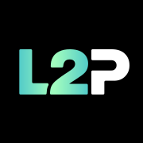

## Logotipos

Haz clic en cualquier tarjeta para descargar el archivo.

<CardGroup cols={2}>
  <Card title="Logo Light (SVG)" icon="bezier-curve" href="/brand_assets/l2pass_logo_light.svg">
    

      
    

    Logotipo vectorial estándar para diseños con tema oscuro.
  </Card>

  <Card title="Logo Dark (SVG)" icon="bezier-curve" href="/brand_assets/l2pass_logo_dark.svg">
    

      
    

    Logotipo vectorial estándar para diseños con tema claro.
  </Card>
</CardGroup>

<CardGroup cols={2}>
  
  <Card title="Polar Light (SVG)" icon="bezier-curve" href="/brand_assets/l2pass_logo_polar_light.svg">
    

      
    

    Variante con degradado Polar para temas claros.
  </Card>

   <Card title="Polar Dark (SVG)" icon="bezier-curve" href="/brand_assets/l2pass_logo_polar_dark.svg">
    

      
    

    Variante con degradado Polar para temas oscuros.
  </Card>
  
  </CardGroup>

<CardGroup cols={2}>
  <Card title="Logo Light (PNG)" icon="file-image" href="/brand_assets/l2pass_logo_light.png">
    

      
    

    Imagen rasterizada de alta resolución para fondos oscuros.
  </Card>

  <Card title="Logo Dark (PNG)" icon="file-image" href="/brand_assets/l2pass_logo_dark.png">
    

      
    

    Imagen rasterizada de alta resolución para fondos claros.
  </Card>
</CardGroup>

   
  

### Iconos y símbolos
<CardGroup cols={2}>

  <Card title="Logotipo cuadrado L2P (SVG)" icon="square" href="/brand_assets/l2p_logo.svg">
    

      
    

    Úsalo como icono cuadrado o favicon.
  </Card>
    <Card title="L2Pass Star (SVG)" icon="star" href="/brand_assets/l2pass_star.svg">
    

      
    

    Símbolo principal de la marca en formato vectorial.
  </Card>

</CardGroup>

<Info>
No modifiques las proporciones, los colores ni la orientación del logotipo. Deja suficiente espacio libre a su alrededor.
</Info>

---

## Colores de marca

Nuestra paleta está pensada para una experiencia de alto contraste con prioridad al modo oscuro, con tonos profundos y acentos neón vivos.

### Principales

<Color variant="compact">
  <Color.Item name="Midnight" value="#1A1A1A" />

  <Color.Item name="Deep Night" value="#181818" />

  <Color.Item name="Ghost White" value="#FCFAF7" />

  <Color.Item name="Ultraviolet" value="#971AE4" />
</Color>

### Secundarios

<Color variant="compact">
  <Color.Item name="Night Blue" value="#5227ff" />

  <Color.Item name="Lavender" value="#B19EEF" />

  <Color.Item name="Neon Mint" value="#A5FFBE" />

  <Color.Item name="Aurora" value="#53CBC8" />
</Color>

### Degradados

<Color variant="table">
  <Color.Row title="Polar Glow">
    <Color.Item name="Aurora" value="#53CBC8" />

    <Color.Item name="Neon Mint" value="#A5FFBE" />
  </Color.Row>

  <Color.Row title="Aurora Pulse">
    <Color.Item name="Neon Green" value="#7CFF67" />

    <Color.Item name="Lavender" value="#B19EEF" />

    <Color.Item name="Night Blue" value="#5227FF" />
  </Color.Row>
</Color>

---

## Tipografía

Usamos tipografías limpias y modernas para que los datos DeFi complejos se lean con facilidad.

<CardGroup cols={3}>
<Card title="SF Pro" icon="font" href="https://developer.apple.com/fonts/">
  Medium, Semi-Bold, Regular, Expanded Thin
</Card>
  <Card title="SF Mono" icon="font" href="https://developer.apple.com/fonts/">
    Medium, Regular, Light
  </Card>
</CardGroup>

---

<Info>
  **Política de uso.** Al usar estos recursos, aceptas seguir las pautas de marca de L2Pass. Para solicitudes personalizadas o materiales para partners, contacta con [nuestro equipo](/es/resources/support).
</Info>