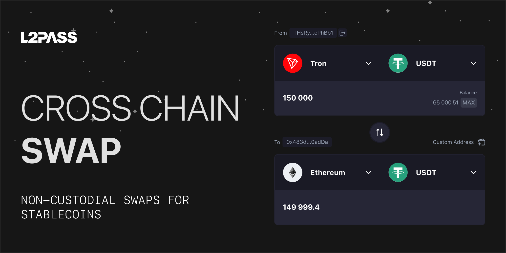

<Frame>
  
</Frame>

[L2Pass Swap](https://swap.l2pass.com/) chuyển token giữa các blockchain, tập trung vào stablecoin. Với mỗi giao dịch, L2Pass hỏi báo giá từ nhiều nhà cung cấp định tuyến độc lập, hiển thị chúng cạnh nhau theo thứ tự số tiền bạn nhận, và cho phép bạn thực hiện tuyến đã chọn chỉ với một lần xác nhận.

L2Pass không bao giờ lưu ký token của bạn. Cầu nối bên thứ ba, mạng solver và nguồn thanh khoản thực hiện từng giao dịch trên hạ tầng của riêng họ.

## Mạng và tài sản được hỗ trợ

L2Pass Swap hiện hỗ trợ **Ethereum, Bitcoin, Zcash, Tron, Solana, TON, BNB Chain, Arbitrum, Base, Polygon, Optimism, Avalanche, Plasma và HyperEVM**.

Stablecoin (USDT, USDT0, USDC, DAI và các loại khác) là trọng tâm chính, nhưng bạn cũng có thể hoán đổi các tài sản lớn như ETH, BTC, SOL, ZEC, TRX, BNB, AVAX và POL. Token, mạng và tuyến khả dụng có thể thay đổi bất cứ lúc nào; [giao diện hoán đổi](https://swap.l2pass.com/) luôn hiển thị danh sách hiện tại.

## Cách định tuyến hoạt động

Khi bạn yêu cầu báo giá, L2Pass đồng thời hỏi nhiều nguồn định tuyến và hiển thị mọi tuyến có thể thực hiện giao dịch của bạn, sắp xếp theo số tiền bạn sẽ nhận:

- **L2Pass RFQ by NEAR Intents:** định tuyến theo yêu cầu báo giá qua mạng [NEAR Intents](https://near.org/intents), nơi các solver và nhà tạo lập thị trường cạnh tranh để khớp giao dịch của bạn.
- **L2Pass Private:** cùng mạng solver, thực hiện trong môi trường bảo mật. Xem [Hoán đổi riêng tư](#private-swaps).
- **USDT Native Bridge:** chuyển USDT0 gốc qua LayerZero, kể cả từ Tron.
- **USDC Native Bridge:** chuyển USDC gốc qua Circle CCTP V2, ở chế độ Standard và Fast.
- **Bộ tổng hợp và mạng intent:** LI.FI, LI.FI Intents, Relay, Aori và bộ tổng hợp OKX DEX.

Mỗi thẻ tuyến hiển thị số tiền dự kiến, số tiền nhận tối thiểu, thời gian ước tính và phí của tuyến đó, để bạn chọn tuyến phù hợp. Một số tuyến có số tiền hoán đổi tối thiểu; nếu số tiền của bạn thấp hơn, tuyến sẽ hiện là không khả dụng kèm mức tối thiểu.

## Cách thực hiện một giao dịch

Tùy theo tuyến, giao dịch được thực hiện theo một trong hai cách:

- **Giao dịch từ ví:** bạn ký giao dịch trong ví và hợp đồng của tuyến thực hiện hoán đổi và chuyển cầu on-chain.
- **Địa chỉ nạp:** với tuyến RFQ và Private, bạn gửi token đến địa chỉ nạp dùng một lần cho báo giá của bạn. Bạn có thể gửi từ ví đã kết nối, hoặc chuyển thủ công từ bất kỳ ví hay sàn nào bằng địa chỉ hoặc mã QR. Nếu gửi từ sàn, hãy kiểm tra số tiền đến có khớp với báo giá không, vì một số sàn trừ phí rút. Sau đó giao dịch đi qua *Awaiting deposit*, *Deposit confirmed* và *Complete*, bạn có thể theo dõi trong **Recent swaps**.

Với tuyến dùng địa chỉ nạp, bạn cũng đặt địa chỉ hoàn tiền trên chuỗi nguồn. Nếu giao dịch không thể hoàn tất, nhà cung cấp sẽ gửi khoản nạp về đó.

## Một giao dịch mất bao lâu

Hầu hết giao dịch hoàn tất trong vài giây đến vài phút, và mỗi thẻ tuyến hiển thị thời gian ước tính trước khi bạn xác nhận.

- **Relay, Aori và CCTP Fast:** vài giây đến khoảng một phút.
- **L2Pass RFQ và L2Pass Private:** 30 giây đến vài phút, lâu hơn với Bitcoin hoặc Zcash do phải chờ xác nhận khối.
- **USDT0:** vài phút.
- **CCTP Standard:** tới 20 phút, trong lúc chờ khối được chốt (finality).

Tắc nghẽn mạng hoặc sự cố của nhà cung cấp có thể khiến giao dịch lâu hơn ước tính.

## Trượt giá và tác động giá

**Tác động giá** là mức thay đổi giá do quy mô giao dịch so với thanh khoản sẵn có. So sánh nhiều nguồn giúp giữ mức này thấp.

**Trượt giá (slippage)** là chênh lệch giữa giá báo và giá thực hiện cuối cùng.

- **Mức chịu trượt giá:** mặc định là **0,05%**. Bạn có thể đổi trên bất kỳ thẻ tuyến nào.
- **Số tiền cố định:** một số tuyến, như cầu nối gốc USDT0 và USDC, giao số tiền cố định, nên không áp dụng trượt giá.
- **Số tiền nhận tối thiểu:** mỗi thẻ tuyến hiển thị số tiền nhận tối thiểu, kết quả xấu nhất trong mức chịu trượt giá của bạn. Nếu giá vượt quá mức này, giao dịch không được thực hiện: tuyến on-chain được hoàn tác, còn tuyến dùng địa chỉ nạp trả khoản nạp về địa chỉ hoàn tiền của bạn.

## Cấu trúc phí

Thẻ tuyến hiển thị phí thực tế của giao dịch trước khi bạn xác nhận. **Số tiền dự kiến trên mạng đích đã bao gồm mọi khoản phí**, trừ gas trên chuỗi nguồn và phí tin nhắn cầu nối (nếu có), bạn trả riêng.

### Phí L2Pass

| Loại giao dịch | Phí L2Pass |
| :-- | :-- |
| Hoán đổi stablecoin (mọi tuyến) | **0%** |
| Tài sản khác | **tối đa 0,2%** |
| Hoán đổi riêng tư, mọi tài sản (thay cho 0% hoặc 0,2%, không cộng thêm) | **tối đa 0,3%** |

### Phí đối tác và phí mạng

Đối tác định tuyến (cầu nối, mạng solver, bộ tổng hợp và nhà cung cấp thanh khoản) có thể thu phí riêng. L2Pass không kiểm soát các khoản phí này; để có thông tin mới nhất, hãy xem tài liệu của từng nhà cung cấp.

Mỗi giao dịch blockchain cũng cần phí mạng (gas) trả bằng token gốc, như ETH, POL, BNB hoặc TRX. Phí gas trả cho mạng, không phải cho L2Pass, và không được hoàn lại.

## Hoán đổi riêng tư

Hoán đổi riêng tư đưa giao dịch của bạn qua môi trường thực thi bảo mật thay vì công khai, giúp hạn chế những gì hiển thị trên blockchain công khai. Tính năng này có được nhờ NEAR Intents, một giao thức bên thứ ba.

- **Không phải ẩn danh:** địa chỉ ví công khai của bạn vẫn có trong các yêu cầu gửi tới nhà cung cấp.
- **Sàng lọc như nhau:** hoán đổi riêng tư được sàng lọc giống hệt giao dịch công khai, ở bước báo giá và sau khi nạp.
- **Phí:** phí L2Pass cho hoán đổi riêng tư tối đa 0,3% (thay cho 0% hoặc 0,2%, không cộng thêm). Như mọi khoản phí, nó đã được tính vào số tiền hiển thị trong báo giá.

Xem [Điều khoản dịch vụ](https://l2pass.com/terms-of-service) và [Nguyên tắc quyền riêng tư và AML](https://l2pass.com/privacy-policy) để biết chi tiết.

## Khớp toàn bộ hoặc hoàn tiền toàn bộ

Một giao dịch hoặc hoàn tất toàn bộ, hoặc không thực hiện, và giao dịch thất bại được hoàn tiền tự động.

- **Không khớp một phần:** L2Pass không dùng khớp lệnh một phần. Giao dịch hoặc hoàn tất toàn bộ, hoặc không thực hiện.
- **Hoàn tiền:** nếu giao dịch qua địa chỉ nạp không thể hoàn tất, chẳng hạn vì giá vượt mức chịu trượt giá hoặc báo giá hết hạn, nhà cung cấp gửi khoản nạp về địa chỉ hoàn tiền của bạn, sau khi trừ phí nhà cung cấp và phí mạng. Giao dịch ví thất bại sẽ được hoàn tác, và phí gas đã trả sẽ mất.
- **Xem xét tuân thủ:** mọi giao dịch đều được sàng lọc, không cần KYC. Trên L2Pass RFQ và L2Pass Private, địa chỉ bị gắn cờ không nhận được báo giá. Khoản nạp bị gắn cờ sau khi đến nơi sẽ bị giữ lại để xem xét thay vì được hoàn trả, và bạn xử lý bằng cách gửi yêu cầu tới bộ phận hỗ trợ của NEAR Intents. Xem [Cách sàng lọc hoạt động](/vi/products/swap/learn/failed-swaps-and-refunds#how-screening-works).

---

<Card icon="circle-question" href="/vi/products/swap/faq" title="Câu hỏi thường gặp về Swap">
  Giải đáp các câu hỏi thường gặp về L2Pass Swap: phí, tuyến, hoàn tiền và mạng được hỗ trợ.
</Card>
